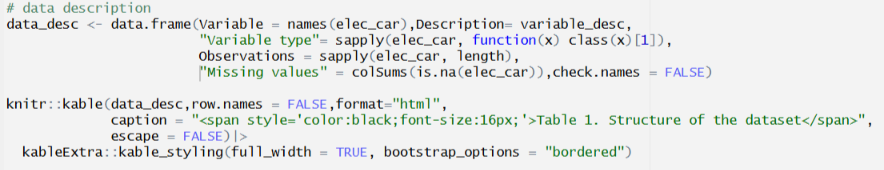

# Introduction

Electric vehicles are fast growing in popularity in Australia and global automotive market. The current fuel crisis has also had a major impact. This report examines the share of new car sales accounted for by battery-electric vehicles (BEVs) and plug-in hybrid electric vehicles (PHEVs) across selected countries from 2015 to 2025, using data from Our World in Data. The analysis aims to identify differences in electric vehicle adoption between countries over time, so will focus on the following questions:
- How do the shares of new cars sold as battery-electric and plug-in hybrids vehicles compare across selected countries or regions from 2015 to 2025? 

```{r setup, include=FALSE}
knitr::opts_chunk$set(echo = TRUE, message = FALSE, warning = FALSE,fig.align = "center")

# Section 1: Loading libraries
pacman::p_load(readr,dplyr,ggplot2,tidyverse,knitr,kableExtra,scales,viridis)

# Loading dateset
#elec_car <- read.csv("https://ourworldindata.org/grapher/share-car-sales-battery-plugin.csv?v=1&csvType=full&useColumnShortNames=true")
elec_car <- readr::read_csv("Data/share-car-sales-battery-plugin.csv", show_col_types = FALSE)

```

# Data set introduction

This report uses annual shares of new car sales that are battery-electric or plug-in hybrid vehicles from [Our World in Data](https://ourworldindata.org/grapher/share-car-sales-battery-plugin), which originally sourced from International Energy Agency data. The data set contains observations by country or region from 2010 to 2025.

`Entity` identifies the country or region, `Code` is its geographic code, and `Year` is the observation year. `Plug_in_hybrid` is the percentage of new cars sold that are plug-in hybrids, while `Battery_electric` is the corresponding percentage for fully battery-electric vehicles. These values represent shares of new car sales, not the share of all cars on the road.

```{r data-exploration-preparation, echo=FALSE}
# Describe the variables
variable_desc <- c("Geographic entity (country or region)",
                   "Geographic county or regional code",
                   "Year of observation","Share of new car sold that are plug-in hybrid",
                   "Share of new car sold that are battery-electric")

# data description
data_desc <- data.frame(Variable = names(elec_car),Description= variable_desc,
                        "Variable type"= sapply(elec_car, function(x) class(x)[1]),
                        Observations = sapply(elec_car, length),
                        "Missing values" = colSums(is.na(elec_car)),check.names = FALSE)

knitr::kable(data_desc,row.names = FALSE,format="html",
             caption = "<span style='color:black;font-size:16px;'>Table 1. Structure of the dataset</span>", 
             escape = FALSE)|>
  kableExtra::kable_styling(full_width = TRUE, bootstrap_options = "bordered")

# Preparing data for plotting
selected_entities<- c("World","European Union (27)","China","Australia",
                      "United Kingdom","United States","Norway","Germany","Japan")

#checking country and region max and mean, using this in data summary
country_summary <- elec_car|>
  filter(Entity %in% selected_entities, Year >= 2015, Year <= 2025)|>
  group_by(Entity)|>
  summarise(mean_bev_percentage = round(mean(bev_share_car_sales, na.rm = TRUE), 1),
    max_bev_percentage = round(max(bev_share_car_sales, na.rm = TRUE), 1),
    mean_phev_percentage = round(mean(phev_share_car_sales, na.rm = TRUE), 1),
    max_phev_percentage = round(max(phev_share_car_sales, na.rm = TRUE), 1),
    .groups = "drop")|>
  arrange(desc(mean_bev_percentage))

# Prepare data for plotting
plot_data <- elec_car|>
  filter(Entity %in% selected_entities,Year >= 2015,Year <= 2025)|>
  select(Entity, Year, bev_share_car_sales,phev_share_car_sales)|>
  mutate(Entity = factor(Entity, levels = selected_entities))

# top battery-elec country 
top <- country_summary|> slice_max(mean_bev_percentage, n = 1, with_ties = FALSE)

```

# Data set description

The full data set contains **`r nrow(elec_car)` observations** and **`r ncol(elec_car)` variables**.

**Figure 1. Screenshot of R code for data description**
```{r code-screenshot, echo=FALSE, out.width='85%'}

```

The first two rows of data, with their variable names and data types, are displayed below using `str()`:
```{r str-display-first-two-rows,echo=FALSE}
str(head(elec_car, 2))
```

# Data summary

The following Table 2 summarises maximum value and mean value for ten selected countries and regions over time. For each country or region, it presents the **mean** and **maximum** of both numerical variables; the grouping variable is `Entity`.

```{r summary-table, echo=FALSE}
country_summary|>
  head(10)|>
  knitr::kable(format="html",caption = "<span style='color:black;font-size:16px;'>Table 2. Mean and maximum shares of new car sales in selected countries and regions, 2015–2025</span>",digits = 1,escape = FALSE,align = c("l", "r", "r", "r", "r"))|>
  kableExtra::kable_styling(full_width = TRUE, bootstrap_options = "bordered")
```

Among these locations, **`r top$Entity[1]`** has the highest mean battery-electric sales share at `r top$mean_bev_percentage`% between 2015 and 2025. The differences in average battery-electric and plug-in hybrid car sales shares across the selected countries and regions indicate varying pattern of vehicle adoption.

Table 3 compares battery-electric vehicle sales shares in 2015 and 2025 across the nine selected geographical entities. 

```{r additional-table, echo=FALSE}
# Adding an additional table
bev_change <- plot_data|>
  filter(Year %in% c(2015, 2025))|>
  select(Entity, Year, bev_share_car_sales)|>
  pivot_wider(names_from = Year,values_from = bev_share_car_sales,names_prefix = "BEV_")|>
  mutate(Change = BEV_2025 - BEV_2015)|>
  arrange(desc(Change))

knitr::kable(bev_change,format = "html",digits = 1,escape = FALSE,
             col.names = c("Country/Region","2015 (%)","2025 (%)","Change (%)"),
             caption = "<span style='color:black;font-size:16px;'>Table 3. Change in battery-electric sales share</span>",
             align = c("l", "r", "r", "r"))|>
  kableExtra::kable_styling(full_width = TRUE,bootstrap_options = "bordered")
```

As shown in Table 3, battery-electric vehicle sales shares increased across all nine selected countries and regions from 2015 to 2025. Norway recorded the largest increase of 78.6%, followed by China (31.9%), while Japan experienced the smallest increase (1.6%), highlighting substantial differences in the pace of electric vehicle adoption across markets.

# Visualisations
To examine differences in electric vehicle adoption, Figure 2 illustrates the trends in battery-electric and plug-in hybrid vehicle sales shares across nine selected countries and regions from 2015 to 2025.

**Figure 2. Battery-electric and plug-in hybrid new car sales shares across nine selected countries and regions, 2015–2025**
```{r line-chart, fig.width=12, fig.height=10, echo=FALSE}
# Plot two lines for nine entities
ggplot(plot_data, aes(x = Year))+
  geom_line(aes(y = bev_share_car_sales,colour = "Battery-electric"),linewidth = 0.9)+
  geom_point(aes(y = bev_share_car_sales,colour = "Battery-electric"),size = 1.5)+
  geom_line(aes(y = phev_share_car_sales,colour = "Plug-in hybrid"),linewidth = 0.9)+
  geom_point(aes(y = phev_share_car_sales,colour = "Plug-in hybrid"),size = 1.5)+
  facet_wrap(~ Entity, ncol = 3)+
  scale_colour_manual(values = c("Battery-electric" = "skyblue",
                                 "Plug-in hybrid" = "darkred"))+
  scale_x_continuous(breaks = c(2015, 2020, 2025))+
  labs(x = "Year",y = "Share of new car sales (%)",colour = NULL)+
  theme_minimal(base_size=15)+
  theme(axis.title.x = element_text(size = 15),
        axis.title.y = element_text(size = 15),
        axis.text.x = element_text(size = 12),
        axis.text.y = element_text(size = 12),
        strip.text = element_text(size = 15, face = "bold"),
        legend.text = element_text(size = 14),
        legend.position = "bottom",
        panel.grid.minor = element_blank())
```

- *Battery-electric vehicle sales shares increased substantially between 2015 and 2025 across most selected countries and regions, with Norway showing the strongest growth, reaching approximately 95% in 2025, followed by China at around 32%.*
- *Battery-electric vehicles generally had higher sales shares than plug-in hybrids, particularly in recent years, while Japan and the United States showed relatively low adoption rates compared with Norway and China.*

Figure 3 compares the new car sales with battery-electric and plug-in hybrid vehicle types across nine selected countries and regions in 2025. The bar chart highlights differences in their adoption patterns across markets.

**Figure 3. Share of new cars sold with battery-electric and plug-in hybrid vehicles in 2025**

```{r bar-chart, echo=FALSE, fig.width=12, fig.height=10}
# Adding an additional figure
bar_data <- plot_data|>
  filter(Year == 2025)|>
  select(Entity, bev_share_car_sales,phev_share_car_sales)|>
  mutate(total_share = bev_share_car_sales+phev_share_car_sales)|>
  pivot_longer(cols = c(bev_share_car_sales,phev_share_car_sales),
    names_to = "vehicle_type",values_to = "sales_share")|>
  mutate(Entity = reorder(Entity, total_share),
         vehicle_type = factor(vehicle_type,levels = c("bev_share_car_sales","phev_share_car_sales"),
                               labels = c("Battery-electric","Plug-in hybrid")))

# Create total labels
label_data <- bar_data|>
  group_by(Entity)|>
  summarise(total_share = sum(sales_share, na.rm = TRUE))

# Stacked bar chart
ggplot(bar_data, aes(x = Entity, y = sales_share, fill = vehicle_type))+
  geom_col(width = 0.7)+
  geom_text(data = label_data,aes(x = Entity, y = total_share, label = sprintf("%.1f%%", total_share)),
            hjust = -0.15,size = 5,inherit.aes = FALSE)+
  coord_flip()+
  scale_fill_manual(values = c("Battery-electric" = "skyblue","Plug-in hybrid" = "navy"))+
  scale_y_continuous(expand = expansion(mult = c(0, 0.12)))+
  labs(x = NULL,y = "Share of new car sales (%)",fill = NULL)+
  theme_minimal(base_size = 16) +
  theme(axis.text.y = element_text(size = 14,colour="black"),axis.text.x = element_text(size = 13),
        axis.title.y = element_text(size = 15),axis.title.x = element_text(size = 15),
        legend.text = element_text(size = 14),legend.position = "bottom",
        panel.grid.major.y = element_blank(),panel.grid.minor = element_blank())
```

As shown in Figure 3, Norway recorded the highest combined electric vehicle sales share at 97%, predominantly driven by battery-electric vehicles, while China also showed substantial adoption. In contrast, Japan, Australia and the United States recorded relatively lower electric vehicle sales shares, highlighting significant differences in adoption and vehicle preferences across the selected countries and regions.

# Conclusion

The analysis finds substantial differences in electric vehicle adoption across the nine selected countries and regions between 2015 and 2025. **Battery-electric** vehicle sales shares increased across most markets, with **`r top$Entity[1]`** demonstrating the strongest growth, reaching to 97% of new car sales in 2025. China also recorded substantial growth, while Japan and the United States showed relatively low electric vehicle sales shares. Plug-in hybrid adoption remained comparatively modest across most markets, with Norway showing a declining trend in recent years. The additional bar chart highlights differences in the composition of electric vehicle sales across markets, while the comparison table demonstrates the uneven pace of battery-electric adoption over the decade. 

Overall, battery-electric vehicles have become increasingly important in the global automobile market, although adoption patterns and the pace of growth vary significantly across countries and regions. These differences highlight the uneven transition towards electric mobility and the increasing dominance of battery-electric vehicles over plug-in hybrids.

# Reference {-}

Our world in data. (2025). Share of new cars sold that are battery-electric and plug-in hybrid. https://ourworldindata.org/grapher/share-car-sales-battery-plugin.

RACV. (2026, June 12). Hybrid vs plug-in hybrid vs mild hybrid vs electric vehicle: what’s the difference? https://www.racv.com.au/royalauto/transport/electric-vehicles/hybrid-vs-phev-vs-ev-difference.html.

Wickham, H. & Grolemund, G. (2017). R for Data Science. Chapter 27: R Markdown. https://r4ds.had.co.nz/r-markdown.html.
